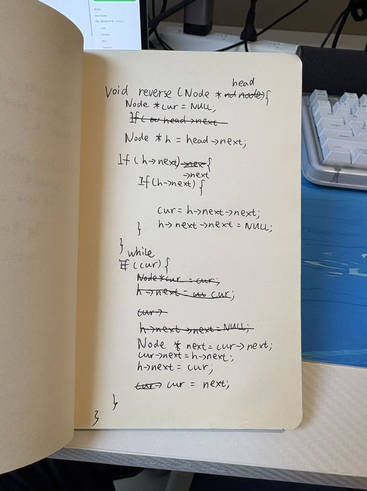

# LL-02 批改：头插法的固定位置应是头结点

日期：2026-10-27。用户提交手写照片并请求“看一下”。实际用时及是否回看提示未说明，不推定完全闭卷。

最新结论：用户随后提出只把 `h = head->next` 改为 `h = head`，其余保留；这一修改正确，包含空表和单结点，验证见文末。以下原始批改保留用于追溯，不能把原代码的错误状态继续套用到订正后的版本。

表达更正（同日）：用户指出原题有 `head → H`，本批改却省略 head，容易被理解成改变结构。助手承认图示不一致且未说明省略，以下已补全。head 是 Node* 指针变量，H 是其指向的 Node 头结点；不是两个链表结点。原代码行为分析基于这一题设约定，不据此把图示造成的困惑归为用户能力不足。先统一表示，再继续验证。



## 判读范围

按未划掉的最终代码判断。忽略手写 Void/If 等大小写，不把它们作为本次算法问题。形参按修改后 head 读取，下方循环按 if 上方改写的 while 读取。

两处 if 有涂改：外层按 `if (h->next)` 读取，内层可能是 `if (h->next)` 或补写后的 `if (h->next->next)`。以下用后者整理；也验证了前者，非空输入上的主要结论相同。此转录带有明确判读假设，原照片保留，不声称是无歧义的逐字源码。

```c
void reverse(Node *head) {
    Node *cur = NULL;
    Node *h = head->next;
    if (h->next) {
        if (h->next->next) { // 有涂改，另一种判读为 if (h->next)
            cur = h->next->next;
            h->next->next = NULL;
        }
    }
    while (cur) {
        Node *next = cur->next;
        cur->next = h->next;
        h->next = cur;
        cur = next;
    }
}
```

## 已能从代码确认的进步

循环中已经保存 `cur->next`，然后改变链接，并用 `cur = next` 推进。它实现的是“将 cur 插在固定结点 h 之后”的头插操作，不必强制改用 prev/cur 的逐边反转写法。

与第一次作答相比，这次不应继续笼统标记为“没有保存后继、没有推进指针”。当前主要错误是固定位置选错、初始化错位及空表访问安全；完整独立实现仍未通过。

## 问题一：h 指向首元结点，导致只反转后半部分

`Node *h = head->next;` 让 h 指向数据结点 1，而不是 H。循环每次插在 1 后，始终不改变 H 指向 1 的链接。

输入 `head（指针变量） → [H] → [1] → [2] → [3] → [4] → NULL`：

```text
准备后：head → [H] → [1] → [2] → NULL        cur → [3] → [4] → NULL
第一轮：head → [H] → [1] → [3] → [2] → NULL  cur → [4] → NULL
第二轮：head → [H] → [1] → [4] → [3] → [2] → NULL
```

此处 head 和 cur 都是指针变量，方括号才表示结点。题目要求 `head → [H] → [4] → [3] → [2] → [1] → NULL`。在题设 head 指向 H 的约定下，结点 1 固定不动，只反转了它后面的部分。两个数据结点时原代码不改变顺序，也不满足要求。

## 问题二：空表时访问了空指针

空表仍有有效 H，但 `head->next == NULL`，于是 h 为 NULL。随后判断 `h->next` 已发生无效解引用。不是 head 参数无效，而是数据结点不存在。单数据结点在上述转录中保持原样，符合该边界要求。

## 沿用用户循环的修正

保留循环，改用 H 作为固定插入位置，并让未处理链从第一个数据结点开始：

```c
void reverse(Node *head) {
    Node *h = head;        // h 指向头结点 H
    Node *cur = h->next;   // 保存原数据链的入口
    h->next = NULL;        // H 后先建立一个空的结果链

    while (cur != NULL) {
        Node *next = cur->next;
        cur->next = h->next;
        h->next = cur;
        cur = next;
    }
}
```

每次将未处理部分的第一个结点插到 H 后，结果依次成为 `head→[H]→[1]→NULL`、`head→[H]→[2]→[1]→NULL`、`head→[H]→[3]→[2]→[1]→NULL`、`head→[H]→[4]→[3]→[2]→[1]→NULL`。head 始终指向 H。先保存原入口再将 `h->next` 置空，原数据链仍可从 cur 找到。空表时 cur 为 NULL，循环不执行；单结点自然正确。不需要单独拆多个 if。

算法每个数据结点处理一次，时间 O(n)，只使用固定数量的指针变量，额外空间 O(1)。仍沿用题设 head 有效的前提。

## 验证证据

- [测试代码](../practice/ll02-check.c) 用两种内层 if 判读验证了 n=1..6 的原代码模型，均固定首元结点而只反转后续结点；n>=2 不满足题意。未运行原模型的空表非法解引用；该问题由上述静态推演确定。
- [助手修正版](../practice/ll02-reversal.c) 在 C11、Wall/Wextra/Werror 的普通构建与单独启用 UndefinedBehaviorSanitizer 的构建中，n=0..6 均通过。
- 首次同时启用 AddressSanitizer/UndefinedBehaviorSanitizer 的运行长时间未返回，已终止；该次不记为通过，也未据此认定算法失败。地址消毒器检查未完成。
- 检查结点地址逆序、原 data 保留、头结点 data 保留和结尾 NULL；数据刻意重复，避免只看值而漏掉交换数据/结点身份问题。
- 通过测试的是助手修正版，不是用户的原始代码，不能据此记为用户已掌握。

## 下一步：LL-02-R1（待回答）

使用修正版，对 `head（指针变量） → [H] → [1] → [2] → NULL` 手推：第一轮循环结束后，`head->next` 和 `cur` 分别指向谁？

回答后再无提示复写同一方法并验证空表/单结点。原 LL-01 三题仍未回答，不追补虚构结果。本题不新增数字分数，记录为“已提交，未通过；已提供纠错，待复写”。

## 后续订正：只改 h=head 即可

用户原话：“明白了，head 是指针，H 才是头结点。那我把 h = head->next 改成 h = head，其他不动，是不是就对了？”

结论：是的。按照片最终未划掉的代码及外层 `if (h->next)` 的判读，只改这一行即可。此前助手提供的“先清空 H 后结果链”版本是另一种有效初始化，不是必须的修改范围。

改动后的原思路是：保留第一个数据结点作为结果链初始内容，从第二个数据结点开始，逐个插到 H 后。

```text
输入：  head → [H] → [1] → [2] → [3] → [4] → NULL
准备后：head → [H] → [1] → NULL     cur → [2] → [3] → [4] → NULL
第一轮：head → [H] → [2] → [1] → NULL
第二轮：head → [H] → [3] → [2] → [1] → NULL
第三轮：head → [H] → [4] → [3] → [2] → [1] → NULL
```

其中 head、cur 是指针变量，方括号表示实际结点。对于两个及以上数据结点，`cur = h->next->next` 取得第二个数据结点，`h->next->next = NULL` 将第一个数据结点与剩余链断开；剩余入口已保存为 cur，所以不丢链。

空表时 h 指向有效 H，`h->next` 是 NULL，外层 if 不进入，cur 保持 NULL，while 不执行，因此安全。单结点时：若内层判为 `if(h->next->next)`，它为假，保持原链；若判为 `if(h->next)`，进入后将 cur 赋为 NULL，并把唯一数据结点的 next 再置 NULL，也正确。两种照片判读不影响结论。

循环每次将一个未处理结点插在 H 后，已处理前缀按逆序排列，未处理后缀由 cur 保持；结束时所有数据结点逆序，H 保留。时间 O(n)、额外空间 O(1)，满足题意。

已扩展 [验证代码](../practice/ll02-check.c)，只切换 h 的初始化，原 if 与循环保留；普通 C11 与 UndefinedBehaviorSanitizer 构建均通过两种内层 if、n=0..6、重复 data 下的结点身份/值/NULL 结尾检查。

学习状态更新为“用户在澄清与反馈后提出正确单行修正，该版本验证通过”。用户正确复述 head/H 区别，不再记录为该区分仍不明确。尚未有无提示完整复写、新题迁移或延后复测证据，因此不标阶段掌握。原 LL-01 和 LL-02-R1 未直接作答，保留历史待答但不作为继续学习的必经门槛。
